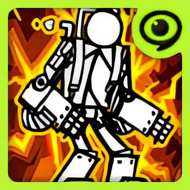

  

<h1 align="center">Cartoon Wars: Gunner</h1>

  Feedback and bug reports for the fan-made Cartoon Wars Gunner port on <a href="https://fanportgames.com/games/cartoon-wars-gunner">FanPortGames</a>.

  
  
  
  

---

## About

Cartoon Wars: Gunner is an action spin-off of the tower-defense game Cartoon Wars, by Blue G&C and published by Gamevil Inc. This repository does not contain the game or any source code. It exists so players of the FanPortGames version can report problems, ask for changes and share ideas in one place.

Downloads, screenshots and the full changelog are on the [game page](https://fanportgames.com/games/cartoon-wars-gunner).

## Report a problem

1. Search the [open issues](../../issues) first, your problem may already be reported.
2. If not, [open a new issue](../../issues/new/choose) and pick **Bug report**.
3. Fill in the form. The more you tell us, the faster it can be fixed:
   - your game version and mod version, shown on the download page
   - your platform (Windows or Android) and its version
   - what happened, what you expected, and the steps to make it happen again
   - a screenshot if it helps

## Suggest something

Have an idea or a change you would like to see? [Open an issue](../../issues/new/choose) and pick **Feature request**.

## Support

If you enjoy the port and want to help, you can support the work on [Ko-fi](https://ko-fi.com/aadhithan). Thank you!

## Disclaimer

This is an unofficial, fan-made version. It is not affiliated with, endorsed by, or supported by Gamevil Inc. (now part of Com2uS). All credit for the original game belongs to its creators; the artwork, animation, music, characters, writing and design are their work and remain the property of their owners. Cartoon Wars is their trademark, used here only to describe what this version contains. Please do not send questions or support requests about this version to Gamevil or Com2uS.
